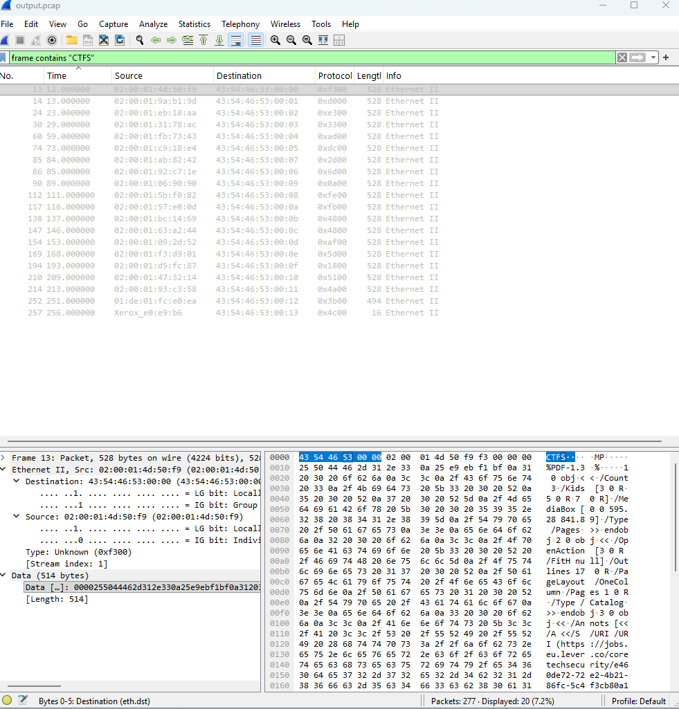

# CTFS Protocol Analysis

What I found inspecting the `output.pcap` replayed traffic in Wireshark.

## Run

```bash
cd tests/coretech
python3 test.py --pcap        
```

Open `output.pcap` in Wireshark and apply the display filter:

```
frame contains "CTFS"
```



Note: Wireshark frame numbers start at 1, so frame N is `packets.all[N-1]` in `buffers.py`.

## What the test harness does

- One TCP connection to `:5733`. All 277 buffers are sent down it with `sendall()`.
- The receiver on `:5744` starts listening only after the sender connects, so connect to 5744 lazily.
- Passes if all 257 non-CTFS buffers are forwarded and none of the 20 CTFS buffers are. Order and the PDF aren't checked.

## CTFS header layout

| Offset | Size | Field |
|---|---|---|
| 0 | 4 | `CTFS` marker |
| 4 | 2 | Sequence number (big-endian) |
| 6 | 2 | Payload length (big-endian) |
| 8 | 8 | Unknown: `01`, 4 varying bytes, `00 00 00` |
| 16 | len | Payload |
 
In frame 13 (seq 0) `%PDF` starts at offset 16, and 16 + 512 = 528 = frame size.


## CTFS packets
 
| Frame | Seq | Len |
|---|---|---|
| 13, 14, 24, 30, 60, 74 | 0–5 | 512 |
| 85, 86 | **7, 6** | 512 |
| 90, 112 | **9, 8** | 512 |
| 117, 138, 147, 154, 169, 194, 210, 214 | 10–17 | 512 |
| 252 | 18 | 478 |
| 257 | 19 | **0** |
 

## Key points
 
- Packets arrive out of order, so reassemble by seq.
- Seq 19 has no payload (likely an end marker).
- PDF = 18 × 512 + 478 = 9,694 bytes.
- TCP can split a header across `recv()` calls.